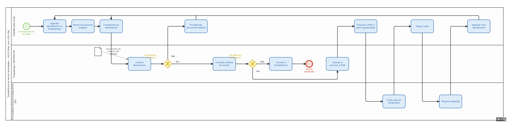
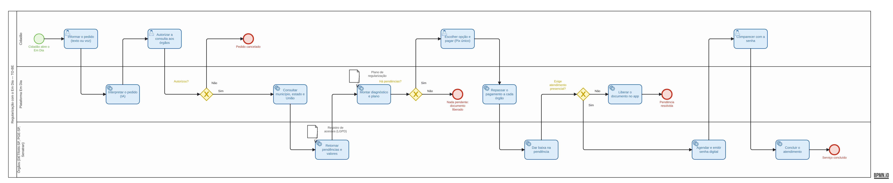

# D2 — Modelagem de processos (BPMN)

Os dois diagramas foram modelados em BPMN 2.0 e estão entregues em formato nativo: modelo do **Bizagi Modeler** ([`D2_BPMN/Em_Dia_Processos.bpm`](D2_BPMN/Em_Dia_Processos.bpm), com as abas *AS-IS* e *TO-BE*) e BPMN 2.0 XML intercambiável ([`Em_Dia_AS-IS.bpmn`](D2_BPMN/Em_Dia_AS-IS.bpmn), [`Em_Dia_TO-BE.bpmn`](D2_BPMN/Em_Dia_TO-BE.bpmn)).

Convenções: piscina por organização, raias por ator, gateways rotulados com a pergunta e as respostas, objeto de dados ligado à tarefa que o usa, e todos os fluxos terminando em evento de fim.

## 2.1 AS-IS — Transferência de veículo arrematado (hoje, sem o Em Dia)

Retrata o processo de hoje a partir da observação no Poupatempo e da história de Seu José: a transferência de um veículo arrematado em leilão que esbarra numa dívida ativa.

- **Raias:** Cidadão (Seu José) · Poupatempo / DETRAN-SP · Procuradoria Geral do Estado (PGE-SP)
- **Evento inicial:** cidadão arremata o veículo · **Evento final:** veículo transferido
- **Gateways:** “Documentos completos?” · “Há débito em dívida ativa?”
- **Objeto de dados:** Documentos do veículo e do cidadão
- Os dois laços de retorno (documento faltante e dívida ativa) são o que faz o cidadão voltar ao posto duas ou três vezes.

## 2.2 TO-BE — Regularização com o Em Dia

O mesmo objetivo com o Em Dia: a plataforma faz a consulta aos órgãos e orquestra pagamento, baixa e agendamento.

- **Raias:** Cidadão · Plataforma Em Dia · Órgãos (DETRAN-SP, PGE-SP, Senatran)
- **Tarefas de usuário:** informar o pedido, autorizar a consulta, escolher a opção e pagar, comparecer com a senha
- **Tarefas de serviço:** interpretar o pedido (IA), consultar as três esferas, montar diagnóstico e plano, repassar o pagamento, dar baixa, liberar o documento, emitir a senha digital
- **Gateways:** “Autorizou?” · “Há pendências?” · “Exige atendimento presencial?”
- **Objetos de dados:** Plano de regularização · Registro de acessos (LGPD)
- **Eventos finais:** pedido cancelado · nada pendente, documento liberado · pendência resolvida · serviço concluído

## 2.3 O que muda

| Hoje (AS-IS) | Com o Em Dia (TO-BE) |
| :--- | :--- |
| O cidadão descobre a pendência no guichê, depois de agendar, reunir papéis e esperar. | O cidadão descobre tudo antes de sair de casa, em um único diagnóstico, nas três esferas. |
| Cada órgão resolve só a sua parte: o Poupatempo manda procurar a PGE; a PGE emite a guia; o DETRAN só conclui depois. | A plataforma consulta e orquestra os órgãos; o cidadão interage com um fluxo só. |
| Dois laços de retorno e até três idas ao posto. | Um laço só e opcional: comparecer, já com senha, quando a lei exige presença. |
| Pagamentos separados, em sites e guias diferentes. | Um Pix, repassado a cada órgão, com comprovante por órgão e baixa automática. |
| Nenhuma visibilidade de quem consultou os dados do cidadão. | Registro de acessos (LGPD) visível em “quem viu meus dados”. |
