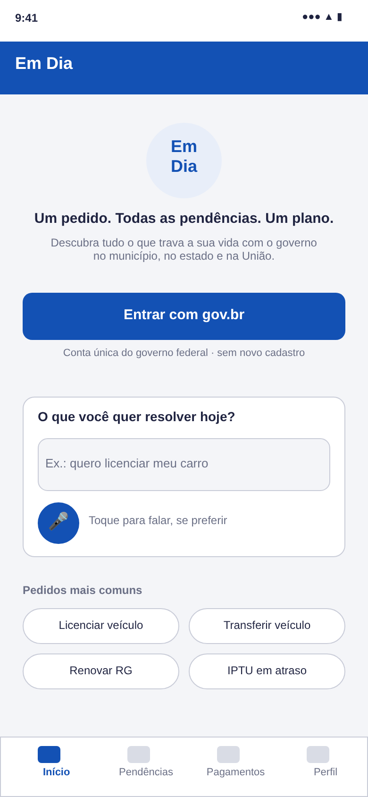
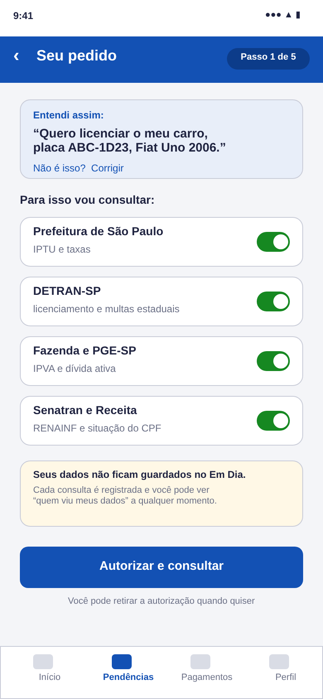
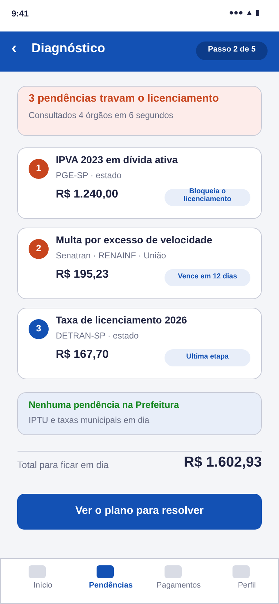
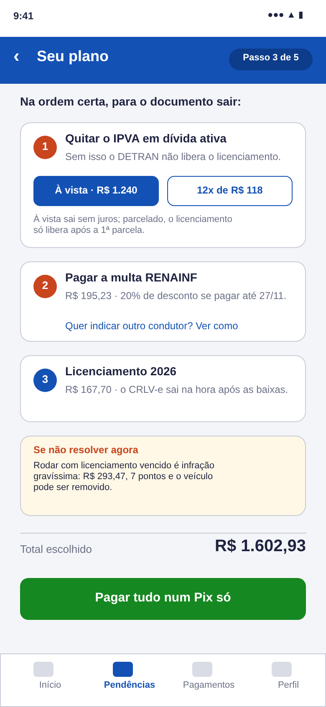
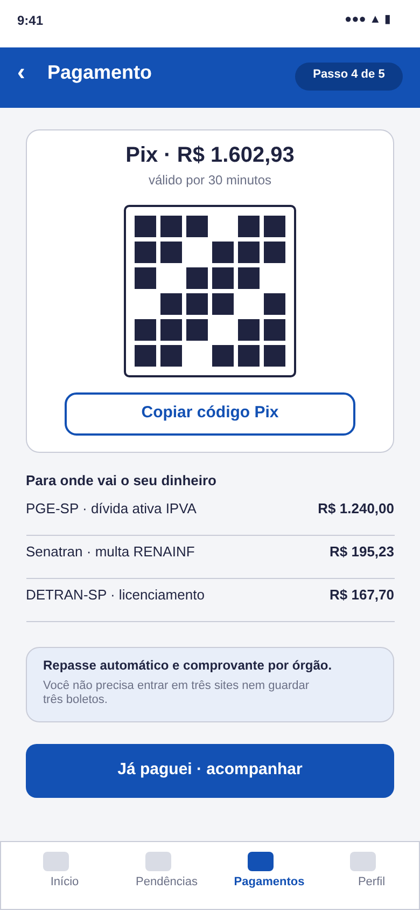
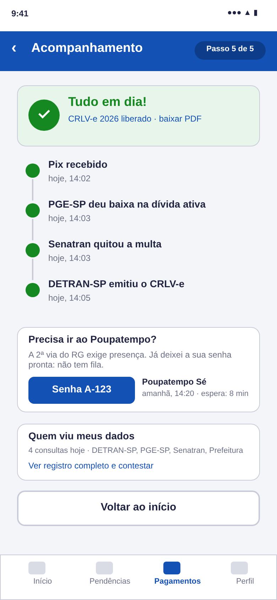

# D3 — Protótipo de telas (Pencil)

Seis telas desenhadas no **Pencil** (arquivo nativo [`D3_Pencil/Em_Dia_Prototipo.epgz`](D3_Pencil/Em_Dia_Prototipo.epgz) e exportações PNG/SVG em [`D3_Pencil/export/`](D3_Pencil/export/)), uma para cada passo da jornada do TO-BE. O fluxo de navegação é linear (Tela 1 → Tela 6), com retorno pelo botão “‹” do cabeçalho e pela barra inferior.

| Tela | Requisitos (D1) | Tarefas do TO-BE (D2) |
| :--- | :--- | :--- |
| 1 · Início e pedido | RF01, RNF02, RNF03 | Informar o pedido (texto ou voz) |
| 2 · Pedido entendido e autorização | RF01, RF07, RNF01, RNF05 | Interpretar o pedido (IA) · Autorizar a consulta · gateway “Autorizou?” |
| 3 · Diagnóstico | RF02, RNF04 | Consultar município, estado e União · Montar diagnóstico |
| 4 · Plano com opções | RF03, RNF05 | Montar plano · gateway “Há pendências?” |
| 5 · Pagamento único | RF04 | Escolher opção e pagar (Pix) · Repassar a cada órgão · Dar baixa |
| 6 · Resolvido e acompanhamento | RF05, RF06, RF07 | Liberar o documento · Agendar e emitir senha · Comparecer com a senha |

## Tela 1 · Início e pedido

Porta de entrada. O cidadão entra com a conta gov.br que já tem e diz, por texto ou voz, o que quer resolver. Atende o requisito RF01 (pedido em linguagem natural) e inicia o TO-BE.

## Tela 2 · Pedido entendido e autorização

A IA mostra como entendeu o pedido e quais órgãos vai consultar; o cidadão autoriza cada um. Atende RF01, RF07 (transparência) e RNF01 (LGPD): nada é consultado sem consentimento.

## Tela 3 · Diagnóstico de pendências

Funcionalidade central: em segundos o app lista tudo o que trava o pedido, com o órgão de origem e o valor. Atende RF02 (diagnóstico nas três esferas) e corresponde à tarefa de serviço “Montar diagnóstico” do TO-BE.

## Tela 4 · Plano com opções e consequências

O app ordena as pendências na sequência correta e explica, em linguagem simples, as opções e o que acontece em cada uma. A IA explica; quem decide é o cidadão (RF03, RNF05).

## Tela 5 · Pagamento único (Pix)

Um pagamento só; o Em Dia repassa o valor a cada órgão e acompanha a baixa. Entrega de valor do RF04 e das tarefas de serviço “Repassar o pagamento” e “Dar baixa” do TO-BE.

## Tela 6 · Resolvido e acompanhamento

Resultado: baixas confirmadas, documento liberado e, quando o serviço exige presença, a senha já emitida para o Poupatempo. Atende RF05 (acompanhamento), RF06 (senha digital) e RF07 (quem viu meus dados).
