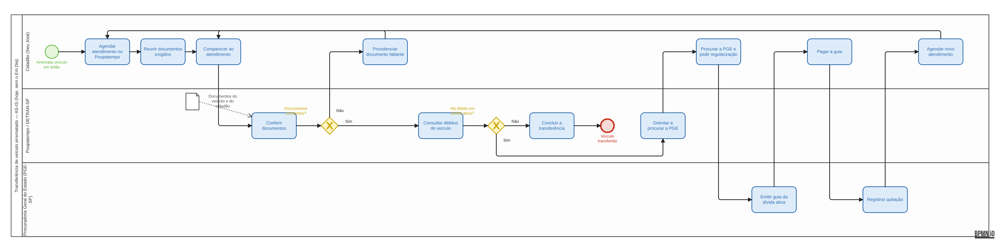
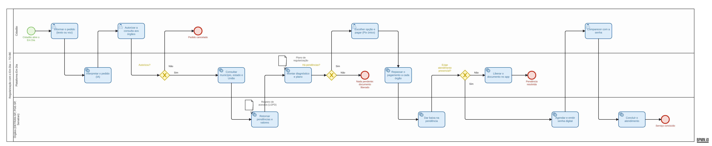

# Modelagem de processos

Dois diagramas em BPMN 2.0 contam a mesma história de dois jeitos: como o cidadão resolve uma pendência hoje e como passa a resolver com o Em Dia. Os arquivos estão na pasta [`Modelagem_de_Processos`](Modelagem_de_Processos/): o modelo do Bizagi Modeler ([`Em_Dia_Modelo_Bizagi.bpm`](Modelagem_de_Processos/Em_Dia_Modelo_Bizagi.bpm), com os dois diagramas em abas) e as versões em BPMN 2.0 XML, que abrem em qualquer ferramenta de modelagem.

Convenções usadas: uma piscina por organização, raias por ator, gateways rotulados com a pergunta e as respostas, objeto de dados ligado à tarefa que o usa e todos os fluxos terminando em um evento de fim.

## 1. Como é hoje: transferência de um veículo arrematado

O processo atual foi levantado na observação do atendimento do Poupatempo e na história de Seu José: a transferência de um veículo comprado em leilão que esbarra numa dívida ativa.

- **Raias:** Cidadão (Seu José), Poupatempo / DETRAN-SP e Procuradoria Geral do Estado (PGE-SP)
- **Começa** quando o cidadão arremata o veículo e **termina** com o veículo transferido
- **Decisões:** "Documentos completos?" e "Há débito em dívida ativa?"
- **Objeto de dados:** documentos do veículo e do cidadão
- Os dois retornos (documento faltante e dívida ativa) são o que faz o cidadão voltar ao posto duas ou três vezes

## 2. Como fica com o Em Dia

O mesmo objetivo, com a plataforma consultando os órgãos e cuidando de pagamento, baixa e agendamento.

- **Raias:** Cidadão, Plataforma Em Dia e Órgãos (DETRAN-SP, PGE-SP e Senatran)
- **O que o cidadão faz:** informa o pedido, autoriza a consulta, escolhe a opção e paga, comparece com a senha quando preciso
- **O que a plataforma faz:** interpreta o pedido (IA), consulta as três esferas, monta o diagnóstico e o plano, repassa o pagamento, dá baixa, libera o documento e emite a senha digital
- **Decisões:** "Autorizou?", "Há pendências?" e "Exige atendimento presencial?"
- **Objetos de dados:** plano de regularização e registro de acessos (LGPD)
- **Quatro finais possíveis:** pedido cancelado; nada pendente e documento liberado; pendência resolvida; serviço concluído no posto

## 3. O que muda

| Hoje | Com o Em Dia |
| :--- | :--- |
| O cidadão descobre a pendência no guichê, depois de agendar, reunir papéis e esperar. | O cidadão descobre tudo antes de sair de casa, em um único diagnóstico, nas três esferas. |
| Cada órgão resolve só a sua parte: o Poupatempo manda procurar a PGE, a PGE emite a guia e o DETRAN só conclui depois. | A plataforma consulta e coordena os órgãos; o cidadão interage com um fluxo só. |
| Dois retornos e até três idas ao posto. | Uma ida, opcional e já com senha, só quando a lei exige presença. |
| Pagamentos separados, em sites e guias diferentes. | Um Pix, repassado a cada órgão, com comprovante por órgão e baixa automática. |
| Nenhuma visibilidade de quem consultou os dados do cidadão. | Registro de acessos (LGPD) visível em "quem viu meus dados". |

