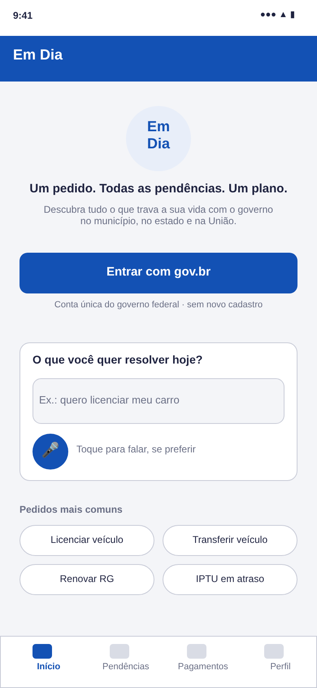
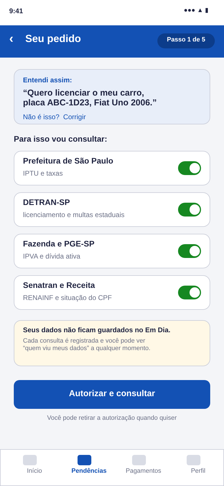
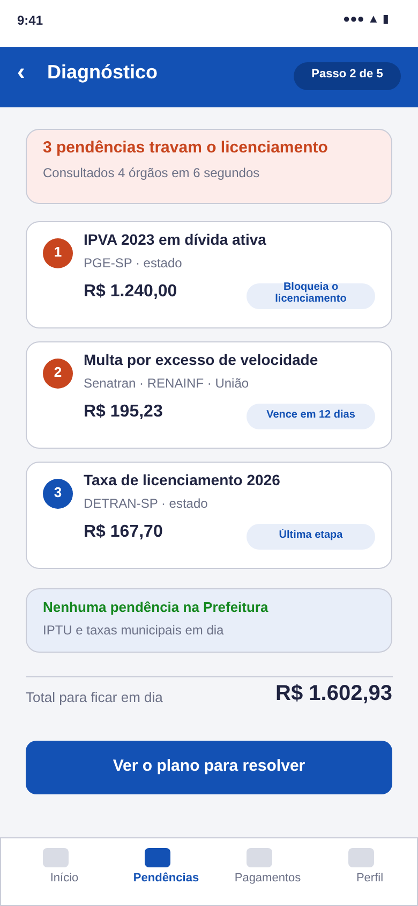
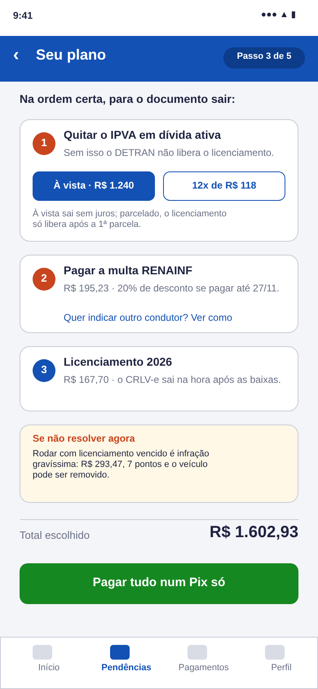
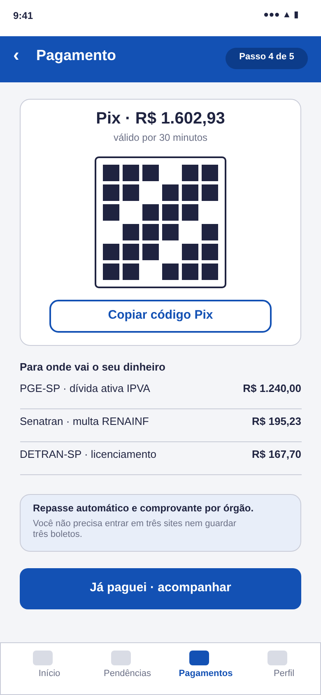
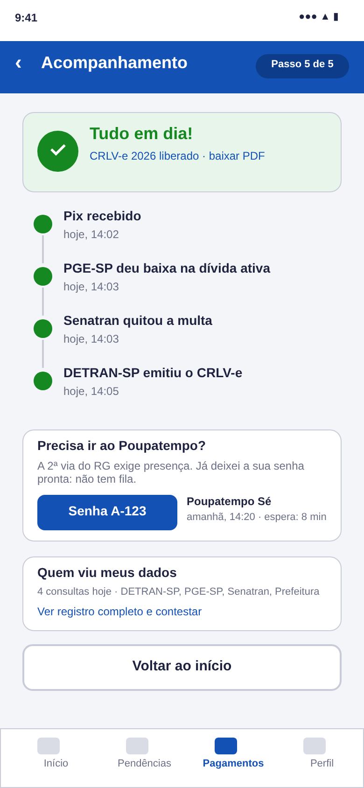

# Protótipo de telas

Seis telas desenhadas no Pencil, uma para cada passo da jornada do processo proposto. O arquivo editável do Pencil é o [`Em_Dia_Prototipo.epgz`](Prototipo_de_Telas/Em_Dia_Prototipo.epgz); as telas exportadas, em PNG e SVG, estão na pasta [`telas`](Prototipo_de_Telas/telas/). A navegação é linear, da tela 1 à tela 6, com retorno pelo botão "‹" do cabeçalho e pela barra inferior.

Cada tela atende requisitos do backlog e materializa tarefas do processo proposto:

| Tela | Requisitos do backlog | Tarefas do processo |
| :--- | :--- | :--- |
| 1. Início e pedido | RF01, RNF02 e RNF03 | Informar o pedido (texto ou voz) |
| 2. Pedido entendido e autorização | RF01, RF07, RNF01 e RNF05 | Interpretar o pedido (IA), autorizar a consulta, decisão "Autorizou?" |
| 3. Diagnóstico | RF02 e RNF04 | Consultar município, estado e União, montar o diagnóstico |
| 4. Plano com opções | RF03 e RNF05 | Montar o plano, decisão "Há pendências?" |
| 5. Pagamento único | RF04 | Escolher a opção e pagar (Pix), repassar a cada órgão, dar baixa |
| 6. Resolvido e acompanhamento | RF05, RF06 e RF07 | Liberar o documento, agendar e emitir a senha, comparecer com a senha |

## Tela 1. Início e pedido

A porta de entrada. O cidadão entra com a conta gov.br que já tem e diz, por texto ou voz, o que quer resolver. Não precisa saber qual órgão cuida de quê.

## Tela 2. Pedido entendido e autorização

A inteligência artificial mostra como entendeu o pedido e quais órgãos vai consultar, e o cidadão autoriza cada um. Nada é consultado sem consentimento, e a tela já avisa que ele poderá ver quem acessou seus dados.

## Tela 3. Diagnóstico de pendências

A funcionalidade central: em segundos o app lista tudo o que trava o pedido, com o órgão de origem e o valor de cada item, e mostra também o que já está em dia.

## Tela 4. Plano com opções e consequências

O app ordena as pendências na sequência correta e explica, em linguagem simples, as opções e o que acontece em cada uma, inclusive o custo de não resolver agora. A IA explica; quem decide é o cidadão.

## Tela 5. Pagamento único

Um Pix só. O Em Dia repassa o valor a cada órgão, mostra para onde vai cada parte e acompanha a baixa. Sem entrar em três sites nem guardar três boletos.

## Tela 6. Resolvido e acompanhamento

O resultado: baixas confirmadas, documento liberado e, quando o serviço exige presença, a senha do Poupatempo já emitida, com horário e tempo de espera previsto. A seção "quem viu meus dados" fecha o ciclo de transparência.
