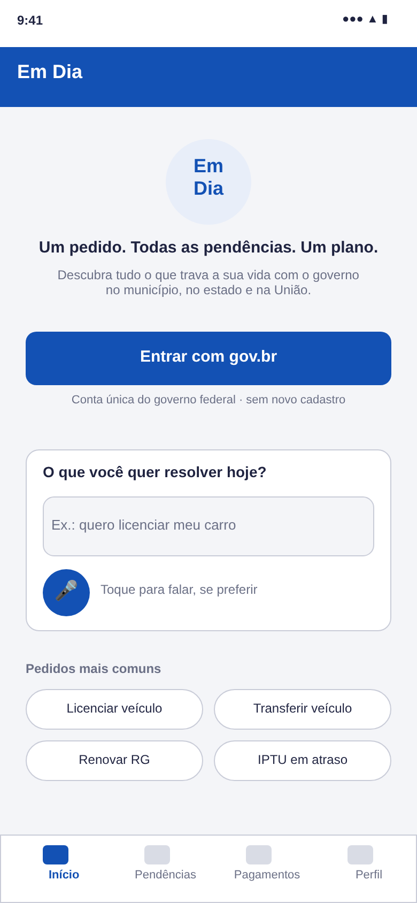
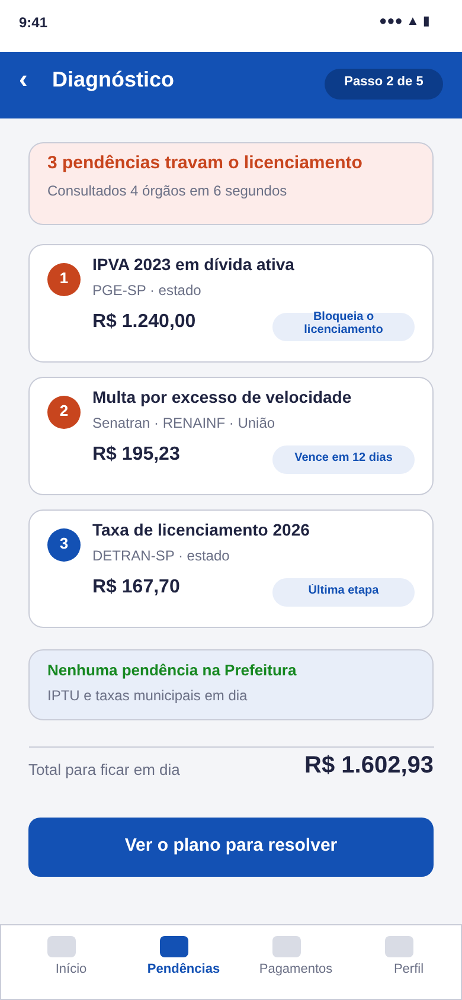
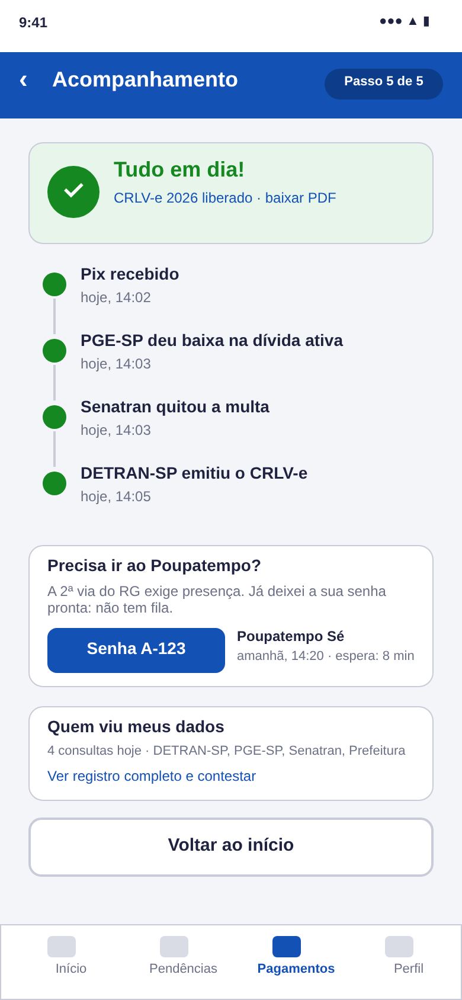
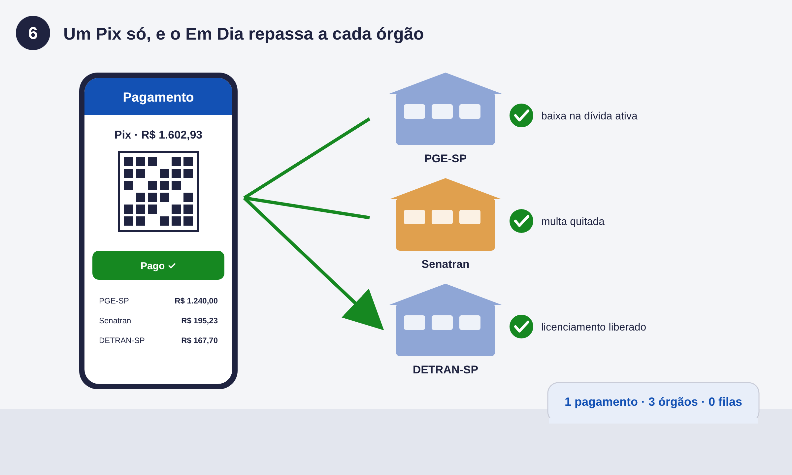

# 🏛️ Em Dia — Global Solution 2026.2

> **Um pedido. Todas as pendências. Um plano.**  
> A CitizenTech que descobre tudo o que trava a vida do cidadão com o governo, no município, no estado e na União, e resolve num plano só.

---

## 📌 Sobre o projeto

Hoje o cidadão descobre a pendência no guichê, depois de agendar, reunir papéis e esperar, e cada órgão resolve só a sua parte: o Poupatempo manda procurar a PGE, a PGE emite a guia, o DETRAN só conclui depois. Com o **Em Dia** ele pede uma vez (texto ou voz), vê em segundos tudo o que o impede nas três esferas, recebe um plano em linguagem simples, paga num único Pix repassado a cada órgão e, quando precisa ir ao posto, já chega com a senha.

| | |
| :--- | :--- |
| **Disciplina** | Business Systems Planning, Analysis & Design |
| **Professor** | Me. Junior Freitas de Amaral |
| **Curso / turma** | Sistemas de Informação · 2SIZ · FIAP |
| **Desafio** | CitizenTech · Global Solution 2026.2 |

---

## 👥 Equipe Em Dia

| Nome | RM |
| :--- | :---: |
| **Guilherme da Cunha** | `567633` |
| **Kenny Tanaka** | `567742` |
| **Pedro Moisés Pereira da Silva** | `567206` |

---

## 🛠️ Tecnologias e ferramentas

- **Back-end:** Java · **Banco:** Oracle · **Testes:** JUnit
- **Autenticação e pagamento:** conta gov.br · Pix
- **IA supervisionada:** interpreta o pedido e explica opções; nunca decide nem paga sozinha
- **Modelagem e prototipação:** Bizagi Modeler (BPMN 2.0) · Pencil (Evolus) · Scrum
- **Rede (simulação):** Cisco Packet Tracer · **Privacidade:** LGPD por padrão

---

## 📂 Entrega

| Parte | Conteúdo | Arquivo |
| :--- | :--- | :--- |
| 📄 Documento único | Capa, D1, D2, D3, D4 e referências (20 páginas) | [`GS_2026-2_Em_Dia_BSPAD.pdf`](GS_2026-2_Em_Dia_BSPAD.pdf) |
| D1 | Planejamento: ciclo de vida, ágil × clássico, Scrum, backlog, sprints, tripla restrição, ODS | [`D1_Planejamento.md`](D1_Planejamento.md) |
| D2 | Modelagem BPMN: AS-IS e TO-BE | [`D2_Modelagem_BPMN.md`](D2_Modelagem_BPMN.md) · [`Em_Dia_Processos.bpm`](D2_BPMN/Em_Dia_Processos.bpm) (Bizagi) · [`.bpmn`](D2_BPMN/) |
| D3 | Protótipo de telas no Pencil (6 telas) | [`D3_Prototipo_Pencil.md`](D3_Prototipo_Pencil.md) · [`Em_Dia_Prototipo.epgz`](D3_Pencil/Em_Dia_Prototipo.epgz) |
| D4 | Storyboard digital (8 quadros) | [`D4_Storyboard.md`](D4_Storyboard.md) · [`D4_Storyboard/`](D4_Storyboard/) |
| 🎤 Pitch | Apresentação e roteiro do vídeo | [`Pitch/`](Pitch/) |
| 📦 Pacote | Todos os arquivos nativos em um ZIP | [`Em_Dia_GS2026-2_Entrega.zip`](Em_Dia_GS2026-2_Entrega.zip) |

---

## 🔁 Processo (D2)

**AS-IS — transferência de veículo arrematado, hoje (sem o Em Dia)**

**TO-BE — regularização com o Em Dia**

---

## 📱 Protótipo no Pencil (D3)

| Tela 1 · Início e pedido | Tela 2 · Autorização | Tela 3 · Diagnóstico |
| :---: | :---: | :---: |
|  |  |  |

| Tela 4 · Plano | Tela 5 · Pagamento único | Tela 6 · Acompanhamento |
| :---: | :---: | :---: |
|  |  |  |

---

## 🎬 Storyboard (D4)

| | |
| :---: | :---: |
|  |  |
|  |  |
|  |  |
|  |  |

---

## 🌍 ODS

| ODS | Meta | Contribuição do Em Dia |
| :--- | :--- | :--- |
| **10** Redução das desigualdades | 10.2 | Pedido em linguagem simples e por voz, senha digital e plano explicado tiram do cidadão o custo de entender a burocracia |
| **9** Indústria, inovação e infraestrutura | 9.c | Conecta a infraestrutura pública que já existe (gov.br, Pix, bases dos órgãos); funciona em celulares básicos |
| **16** Paz, justiça e instituições eficazes | 16.6 · 16.9 · 16.10 | Cada consulta é registrada e visível ao cidadão; as três esferas respondem como um Estado só |
