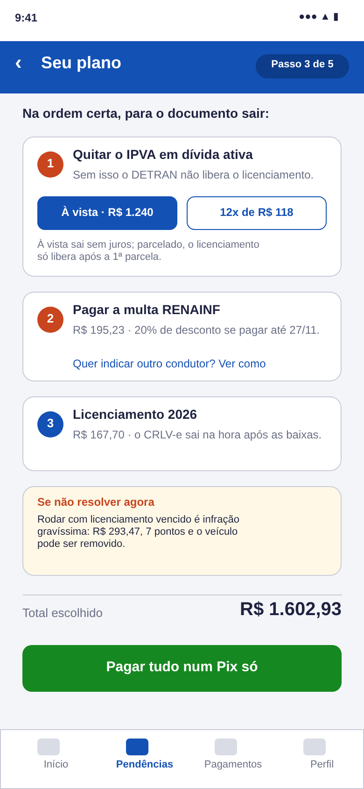
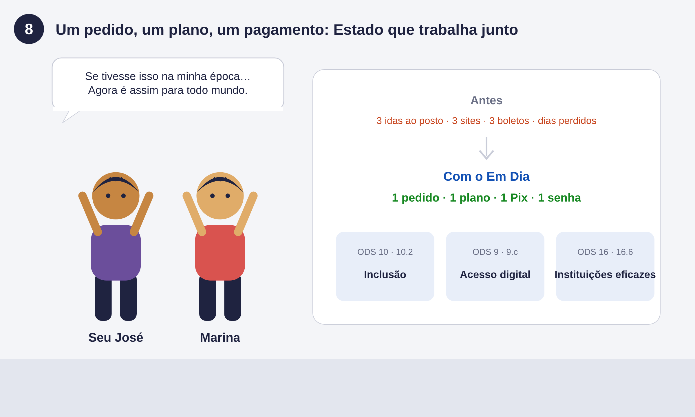

# Em Dia — Global Solution 2026.2

**Um pedido. Todas as pendências. Um plano.**  
A CitizenTech que descobre tudo o que trava a vida do cidadão com o governo, no município, no estado e na União, e resolve num plano só.

| | |
|---|---|
| **Disciplina** | Business Systems Planning, Analysis & Design |
| **Professor** | Me. Junior Freitas de Amaral |
| **Curso / turma** | Sistemas de Informação · 2SIZ · FIAP |
| **Equipe Em Dia** | Guilherme da Cunha (RM 567633) · Kenny Tanaka (RM 567742) · Pedro Moisés Pereira da Silva (RM 567206) |

## Entrega

- **`GS_2026-2_Em_Dia_BSPAD.pdf`** — documento único: capa, D1 (planejamento), D2 (BPMN AS-IS e TO-BE), D3 (protótipo no Pencil), D4 (storyboard) e referências.
- **`Em_Dia_GS2026-2_Entrega.zip`** — todos os arquivos nativos em um só pacote.
- `D2_BPMN/` — modelos do Bizagi Modeler (`.bpm`), BPMN 2.0 intercambiável (`.bpmn`) e imagens dos diagramas.
- `D3_Pencil/` — documento do Pencil (`Em_Dia_Prototipo.epgz`) e as exportações tela a tela (`export/`).
- `D4_Storyboard/` — os 8 quadros do storyboard.
- `Pitch/` — apresentação e roteiro do vídeo da Global Solution.

## O problema e a solução em uma linha

Hoje o cidadão descobre a pendência no guichê, depois de agendar, reunir papéis e esperar, e cada órgão resolve só a sua parte. Com o Em Dia ele pede uma vez (texto ou voz), vê em segundos tudo o que o impede nas três esferas, recebe um plano em linguagem simples, paga num único Pix repassado a cada órgão e, quando precisa ir ao posto, já chega com a senha.

## Processo (D2)

**AS-IS — transferência de veículo arrematado, hoje**

**TO-BE — regularização com o Em Dia**

## Protótipo no Pencil (D3)

| Tela 1 · Início e pedido | Tela 2 · Autorização | Tela 3 · Diagnóstico |
|---|---|---|
|  |  |  |

| Tela 4 · Plano | Tela 5 · Pagamento único | Tela 6 · Acompanhamento |
|---|---|---|
|  |  |  |

## Storyboard (D4)

| | |
|---|---|
|  |  |
|  |  |
|  |  |
|  |  |

## ODS

ODS 10 (10.2 · inclusão) · ODS 9 (9.c · acesso às TIC) · ODS 16 (16.6, 16.9 e 16.10 · instituições eficazes e transparentes).
