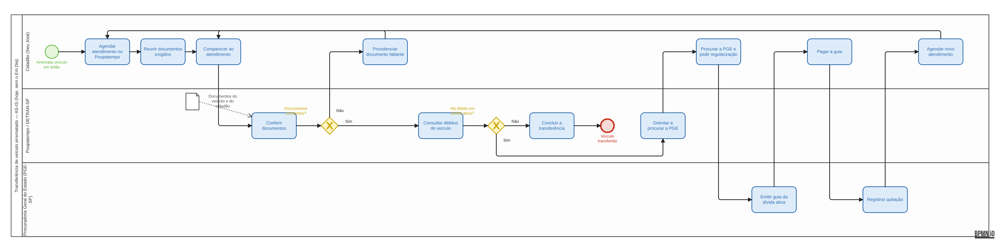
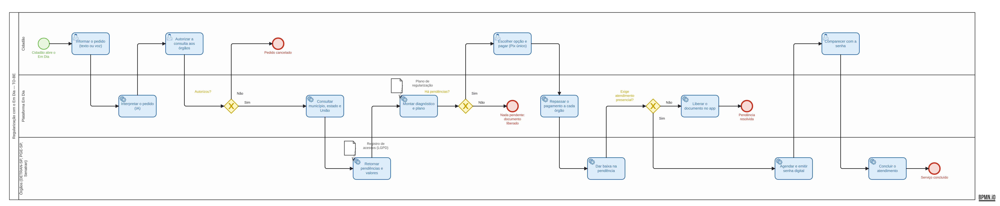
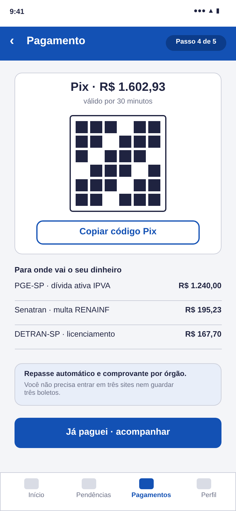
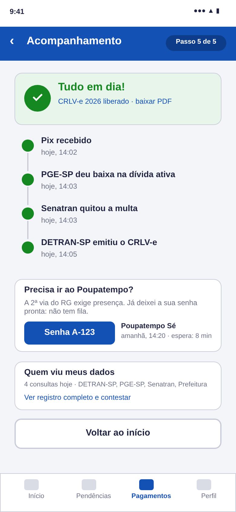
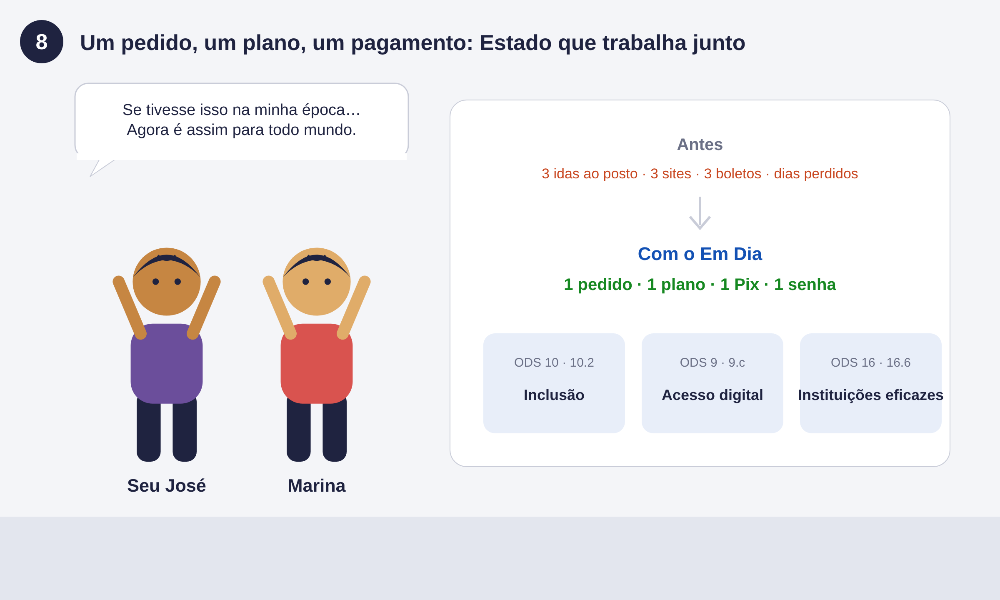

# Em Dia

> **Um pedido. Todas as pendências. Um plano.**
> A CitizenTech que descobre tudo o que trava a vida do cidadão com o governo, no município, no estado e na União, e resolve num plano só.

Projeto da **Global Solution 2026.2** da FIAP, desafio CitizenTech, desenvolvido para a disciplina **Business Systems Planning, Analysis & Design** (Prof. Me. Junior Freitas de Amaral), turma 2SIZ de Sistemas de Informação.

---

## O problema que resolvemos

Hoje o cidadão descobre a pendência no guichê, depois de agendar, reunir papéis e esperar. E cada órgão resolve só a sua parte: o Poupatempo manda procurar a PGE, a PGE emite a guia, o DETRAN só conclui depois. Uma dívida antiga de IPVA pode custar três idas ao posto e dias de trabalho perdidos.

Com o Em Dia, a pessoa pede uma vez, por texto ou voz, e vê em segundos tudo o que a impede nas três esferas de governo. Recebe um plano em linguagem simples, paga num único Pix repassado a cada órgão e, quando precisa ir ao posto, já chega com a senha.

---

## Equipe Em Dia

| Nome | RM |
| :--- | :---: |
| **Guilherme da Cunha** | `567633` |
| **Kenny Tanaka** | `567742` |
| **Pedro Moisés Pereira da Silva** | `567206` |

---

## Tecnologias e ferramentas

- **Aplicação:** Java, banco de dados Oracle e testes com JUnit
- **Acesso e pagamento:** conta gov.br e Pix
- **Inteligência artificial supervisionada:** interpreta o pedido e explica as opções; nunca decide nem paga sozinha
- **Modelagem e prototipação:** Bizagi Modeler (BPMN 2.0), Pencil e Scrum
- **Privacidade:** LGPD por padrão, com consentimento por órgão e registro de todo acesso

---

## O que está neste repositório

| Conteúdo | Onde está |
| :--- | :--- |
| Documento completo da entrega, em PDF (capa, planejamento, processos, protótipo, storyboard e referências) | [`Em_Dia_Entrega_Final.pdf`](Em_Dia_Entrega_Final.pdf) |
| Planejamento do projeto: ciclo de vida, abordagem ágil, Scrum, backlog, sprints, tripla restrição e ODS | [`Planejamento_do_Projeto.md`](Planejamento_do_Projeto.md) |
| Modelagem dos processos em BPMN: como é hoje e como fica com o Em Dia | [`Modelagem_de_Processos.md`](Modelagem_de_Processos.md) e a pasta [`Modelagem_de_Processos`](Modelagem_de_Processos/) com o modelo do Bizagi (`.bpm`), os arquivos BPMN 2.0 e as imagens |
| Protótipo das telas feito no Pencil | [`Prototipo_de_Telas.md`](Prototipo_de_Telas.md) e a pasta [`Prototipo_de_Telas`](Prototipo_de_Telas/) com o arquivo do Pencil (`.epgz`) e as telas exportadas |
| Storyboard da jornada, em oito quadros | [`Storyboard.md`](Storyboard.md) e a pasta [`Storyboard`](Storyboard/) |
| Apresentação e roteiro do vídeo de pitch | pasta [`Pitch`](Pitch/) |

As quatro partes seguem a ordem pedida no roteiro da disciplina (entregáveis 1 a 4).

---

## Como o processo muda

**Hoje: transferência de um veículo arrematado em leilão, sem o Em Dia**

**Com o Em Dia: regularização em um fluxo só**

---

## As telas

| Início e pedido | Autorização | Diagnóstico |
| :---: | :---: | :---: |
|  |  |  |

| Plano | Pagamento único | Acompanhamento |
| :---: | :---: | :---: |
|  |  |  |

---

## A jornada em oito quadros

| | |
| :---: | :---: |
|  |  |
|  |  |
|  |  |
|  |  |

---

## Objetivos de Desenvolvimento Sustentável

| ODS | Meta | Como o Em Dia contribui |
| :--- | :--- | :--- |
| **10** Redução das desigualdades | 10.2 | O pedido em linguagem simples e por voz, a senha digital e o plano explicado tiram do cidadão o custo de entender a burocracia |
| **9** Indústria, inovação e infraestrutura | 9.c | Conecta a infraestrutura pública que já existe (gov.br, Pix e as bases dos órgãos) e funciona em celulares básicos |
| **16** Paz, justiça e instituições eficazes | 16.6, 16.9 e 16.10 | Cada consulta fica registrada e visível ao cidadão, e as três esferas respondem como um Estado só |
