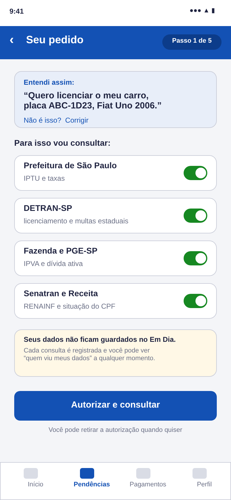
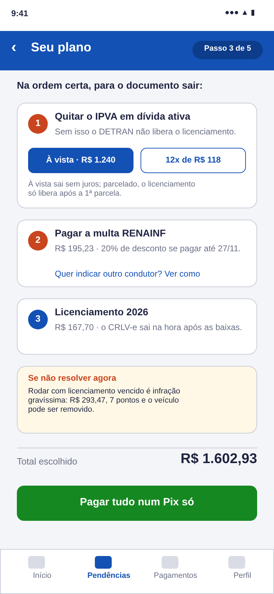
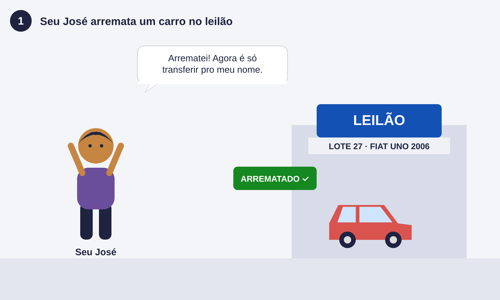

# 🏛️ Em Dia: Global Solution 2026.2

> **Um pedido. Todas as pendências. Um plano.**
> A CitizenTech que descobre tudo o que trava a vida do cidadão com o governo, no município, no estado e na União, e resolve num plano só.

---

## 📌 Sobre o projeto

Hoje o cidadão descobre a pendência no guichê, depois de agendar, reunir papéis e esperar, e cada órgão resolve só a sua parte: o Poupatempo manda procurar a PGE, a PGE emite a guia, o DETRAN só conclui depois. Com o **Em Dia** ele pede uma vez (texto ou voz), vê em segundos tudo o que o impede nas três esferas, recebe um plano em linguagem simples, paga num único Pix repassado a cada órgão e, quando precisa ir ao posto, já chega com a senha.

| | |
| :--- | :--- |
| **Disciplina** | Business Systems Planning, Analysis & Design |
| **Professor** | Junior Freitas de Amaral |
| **Curso / turma** | Sistemas de Informação · 2SIZ · FIAP |
| **Desafio** | CitizenTech · Global Solution 2026.2 |

---

## 👥 Equipe Em Dia

| Nome | RM |
| :--- | :---: |
| **Guilherme da Cunha** | `567633` |
| **Kenny Tanaka** | `567742` |
| **Pedro Moisés Pereira da Silva** | `567206` |

---

## 🛠️ Tecnologias e ferramentas

- **Back-end:** Java · **Banco:** Oracle · **Testes:** JUnit
- **Autenticação e pagamento:** conta gov.br · Pix
- **IA supervisionada:** interpreta o pedido e explica opções; nunca decide nem paga sozinha
- **Modelagem e prototipação:** Bizagi Modeler (BPMN 2.0) · Pencil (Evolus) · Scrum
- **Rede (simulação):** Cisco Packet Tracer · **Privacidade:** LGPD por padrão

---

## 📂 Documentos do projeto

| Etapa | Arquivo |
| :--- | :--- |
| 📄 Documento completo da entrega (capa, planejamento, processos, protótipo, storyboard e referências) | [`Em_Dia_Entrega_Final.pdf`](Em_Dia_Entrega_Final.pdf) |
| 🗂️ Planejamento do projeto: ciclo de vida, abordagem ágil, Scrum, backlog, sprints, tripla restrição e ODS | [`Planejamento_do_Projeto.md`](Planejamento_do_Projeto.md) |
| 🔁 Modelagem de processos em BPMN (como é hoje e como fica com o Em Dia) | [`Modelagem_de_Processos.md`](Modelagem_de_Processos.md) · [`Em_Dia_Modelo_Bizagi.bpm`](Modelagem_de_Processos/Em_Dia_Modelo_Bizagi.bpm) · [`.bpmn`](Modelagem_de_Processos/) |
| 📱 Protótipo das telas no Pencil | [`Prototipo_de_Telas.md`](Prototipo_de_Telas.md) · [`Em_Dia_Prototipo.epgz`](Prototipo_de_Telas/Em_Dia_Prototipo.epgz) |
| 🎬 Storyboard da jornada (oito quadros) | [`Storyboard.md`](Storyboard.md) · [`Storyboard/`](Storyboard/) |
| 🎤 Vídeo de pitch, apresentação e roteiro | [Assistir no YouTube](https://www.youtube.com/watch?v=AiBvizYnln4) · [`Pitch/`](Pitch/) |

---

## 🔁 Modelagem de processos (BPMN)

**Hoje: transferência de um veículo arrematado em leilão, sem o Em Dia**

**Com o Em Dia: regularização em um fluxo só**

---

## 📱 Protótipo no Pencil

| Tela 1 · Início e pedido | Tela 2 · Autorização | Tela 3 · Diagnóstico |
| :---: | :---: | :---: |
|  |  |  |

| Tela 4 · Plano | Tela 5 · Pagamento único | Tela 6 · Acompanhamento |
| :---: | :---: | :---: |
|  |  |  |

---

## 🎬 Storyboard

| | |
| :---: | :---: |
|  |  |
|  |  |
|  |  |
|  |  |

---

## 🌍 ODS

| ODS | Meta | Contribuição do Em Dia |
| :--- | :--- | :--- |
| **ODS 10** · Redução das desigualdades | Meta 10.2 | A burocracia pesa mais em quem tem menos tempo e acesso digital. O pedido em linguagem simples e por voz, a senha digital e o plano explicado tiram do cidadão esse custo |
| **ODS 9** · Inovação e infraestrutura | Meta 9.c | Infraestrutura digital pública que qualquer governo reaproveita: conecta gov.br, Pix e as bases dos órgãos e funciona em celulares básicos |
| **ODS 16** · Instituições eficazes | Metas 16.6, 16.9 e 16.10 | Órgãos que conversam, com transparência: cada consulta é registrada e visível ao cidadão, e as três esferas respondem como um Estado só |

