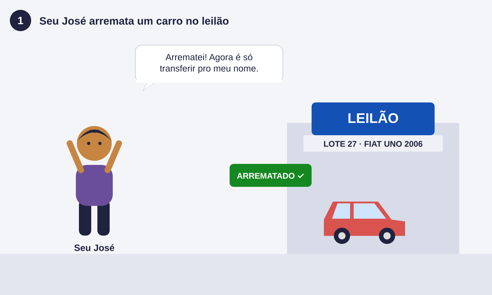
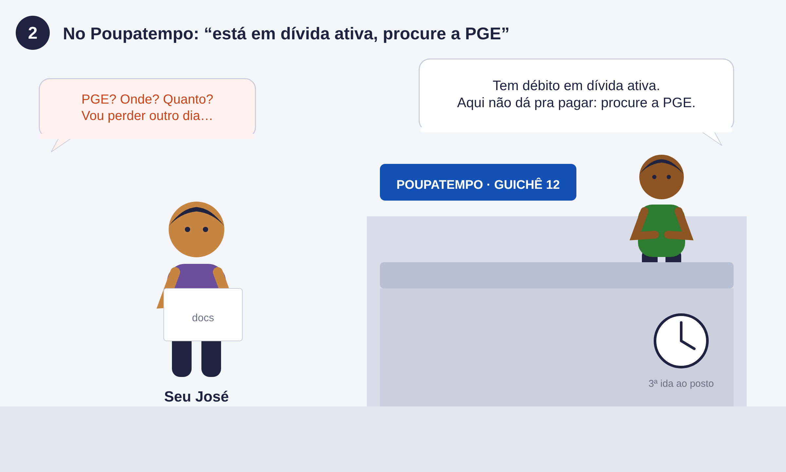
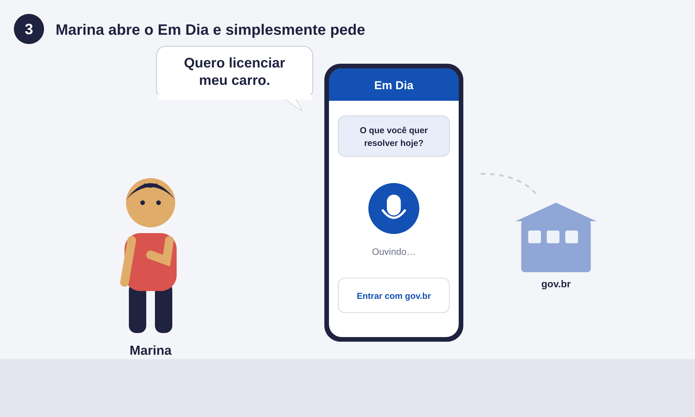
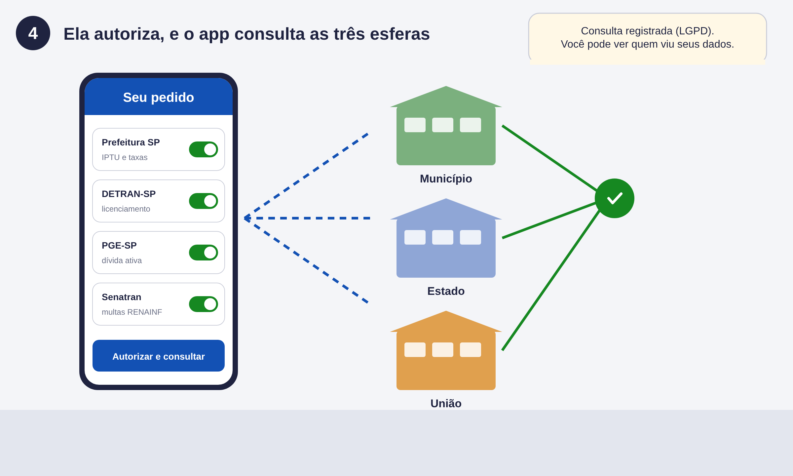
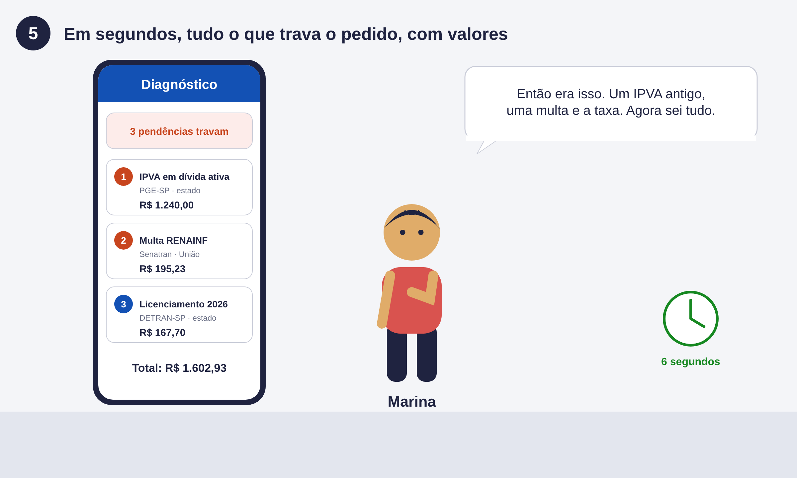
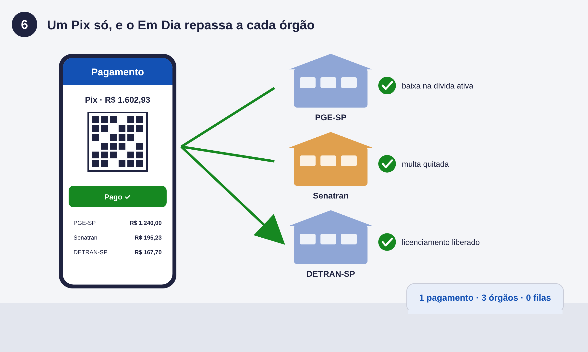
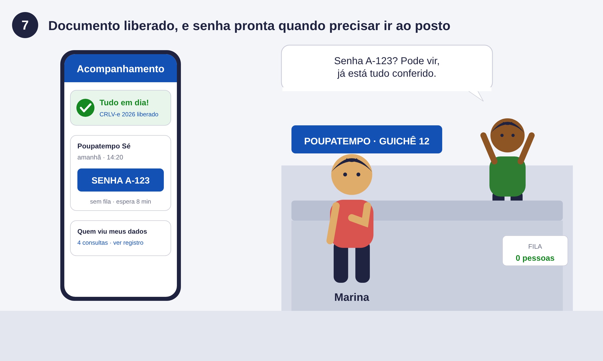
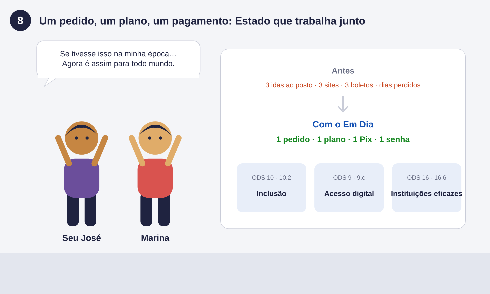

# Storyboard

A jornada em oito quadros, feitos digitalmente (PNG e SVG na pasta [`Storyboard`](Storyboard/)). Os dois primeiros mostram o contexto e o problema, com a história real de Seu José, que inspirou o projeto. Do terceiro ao sexto, Marina usa o Em Dia. Os dois últimos mostram o resultado e o impacto. As telas do protótipo aparecem nas mãos da personagem.

## 1. Seu José arremata um carro no leilão

Seu José, 64 anos, realiza o sonho de comprar um carro num leilão do DETRAN-SP. Para usá-lo, precisa transferir o veículo para o seu nome.

## 2. No Poupatempo: "está em dívida ativa, procure a PGE"

No guichê, depois de agendar e reunir papéis, Seu José descobre uma dívida antiga de IPVA deixada pelo dono anterior. Ninguém sabe dizer quanto é nem onde pagar: "procure a PGE".

## 3. Marina abre o Em Dia e simplesmente pede

Marina, 31 anos, precisa licenciar o carro. Entra com a conta gov.br que já tem e diz, por voz: "quero licenciar meu carro". Não precisa saber qual órgão cuida de quê.

## 4. Ela autoriza, e o app consulta as três esferas

O Em Dia mostra o que entendeu e quais órgãos vai consultar: município, estado e União. Marina autoriza com um toque; nada é consultado sem o seu consentimento.

## 5. Em segundos, tudo o que trava o pedido, com valores

O diagnóstico lista as três pendências que impedem o licenciamento, com o órgão de origem e o valor de cada uma, na ordem em que precisam ser resolvidas.

## 6. Um Pix só, e o Em Dia repassa a cada órgão

Marina escolhe as opções do plano e paga tudo num único Pix. O Em Dia repassa o valor a cada órgão e acompanha cada baixa; ela não entra em três sites nem guarda três boletos.

## 7. Documento liberado, e senha pronta para o que exige presença

Minutos depois, o CRLV-e 2026 aparece no app. Para o que exige presença, como a segunda via do RG, o Em Dia já agenda e emite a senha digital: Marina chega ao Poupatempo e é atendida sem fila.

## 8. Um pedido, um plano, um pagamento

Com o Em Dia, a história de Seu José vira a de Marina: o cidadão pede uma vez e o Estado, nas três esferas, resolve junto. Menos filas e dias perdidos, mais gente regular e mais arrecadação recuperada.

